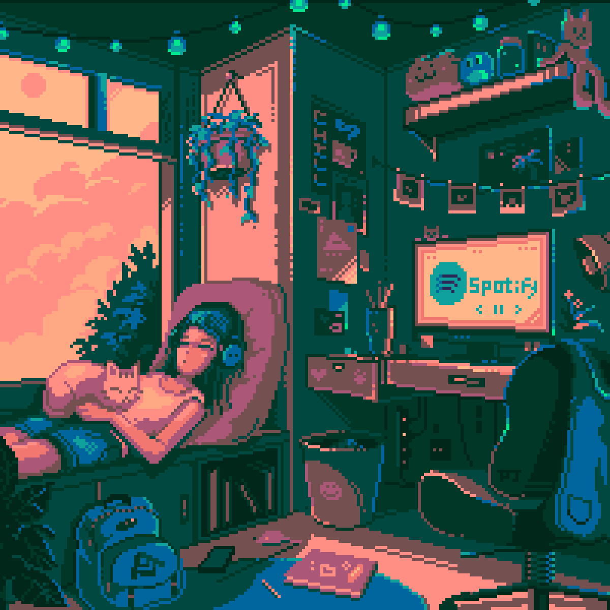

<!-- Banner -->

  <h1>👋 Hello, I'm Meryem!</h1>
  <h3>Application Developer | Python, Data Science & AI Enthusiast</h3>
  

  <!-- Connect with me badges -->
  
  
  
  
  

 

## 👩‍💻 About Me & Focus

- 🎓 **Education:** Atatürk University — Computer Programming Graduate
- 💼 **Experience:** AI Intern @ Marka Mutfağı | AR Developer @ Teknomat Yazılım
- 🚀 **Focus Areas:** Generative AI & RAG Systems, Computer Vision, Modern Web & Distributed Systems
- 💡 **Engineering Mindset:** Building production-ready, impactful solutions — from compiler-level AST analysis to real-time Edge AI models
- 📫 **Contact:** meriguclu123@gmail.com

---

## 🛠️ Skills & Technologies

### 🧠 AI, Data Science & Computer Vision

  
  
  
  
  
  
  
  
  

### 💻 Programming & Web Development

  
  
  
  
  
  
  

### ⚙️ Tools, DevOps & Hardware

  
  
  
  
  
  

---

## 🌟 Featured Projects

| Project Name | Description | Technologies | Links |
| :--- | :--- | :--- | :--- |
| **[AgroBot Tarım Asistanı](https://github.com/meryemgcl/AgroBot_Tarim_Asistani)** | Bilingual (TR/EN) RAG chatbot answering farmers' questions on grants & pest management with inline citations. Runs offline or via Gemini Cloud. | `TypeScript`, `LangChain`, `RAG`, `Gemini API` | [🔗 Repo](https://github.com/meryemgcl/AgroBot_Tarim_Asistani) |
| **[Turkish Sign Language (TİD) Detection](https://github.com/meryemgcl/Turkish-Sign-Language-Detection-)** | Real-time Turkish Sign Language recognition system. Extracts 21 hand landmarks using MediaPipe and classifies gestures with a custom Neural Network. | `Python`, `OpenCV`, `MediaPipe`, `TensorFlow` | [🔗 Repo](https://github.com/meryemgcl/Turkish-Sign-Language-Detection-) |
| **[PortCV Liman Analitik](https://github.com/meryemgcl/PortCV_Liman_Analitik)** | Real-time computer vision dashboard for port terminal management: tracks containers, cranes & trucks with bounding boxes, alerts and zone management. | `Python`, `Computer Vision`, `Docker`, `JavaScript` | [🔗 Repo](https://github.com/meryemgcl/PortCV_Liman_Analitik) |
| **[Autonomous Code Architect](https://github.com/meryemgcl/autonomous-code-architect)** | Enterprise-grade distributed platform merging .NET 9 Roslyn AST analysis with multi-agent consensus for automated code remediation & test generation. | `.NET 9`, `C#`, `Java 21`, `gRPC`, `RabbitMQ` | [🔗 Repo](https://github.com/meryemgcl/autonomous-code-architect) |
| **[AquaGuard App](https://github.com/meryemgcl/aquaguard-app)** | AI-powered, role-based environmental and water quality monitoring platform with real-time analytics. | `Next.js`, `TypeScript`, `React`, `TailwindCSS` | [🔗 Repo](https://github.com/meryemgcl/aquaguard-app) |
| **[Meryem Güçlü Portfolio](https://github.com/meryemgcl/meryem-guclu-portfolio)** | Personal portfolio website featuring matrix code animation, multi-language support (TR/EN), and dynamic project filtering. | `HTML5`, `CSS3`, `JavaScript` | [🔗 Repo](https://github.com/meryemgcl/meryem-guclu-portfolio) \| [🌐 Live](https://meryemgcl.github.io/meryem-guclu-portfolio/) |

---

## 📈 GitHub Statistics

  
  

 

  

---

## 🐍 Contribution Snake

  <picture>
    <source media="(prefers-color-scheme: dark)" srcset="https://raw.githubusercontent.com/meryemgcl/meryemgcl/output/github-contribution-grid-snake-dark.svg">
    <source media="(prefers-color-scheme: light)" srcset="https://raw.githubusercontent.com/meryemgcl/meryemgcl/output/github-contribution-grid-snake.svg">
    
  </picture>

---

  

